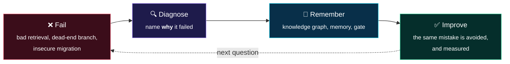

I'm a CSE (AI & ML) student at VIT Chennai. Most of my work asks one question:
**how do you stop a system from repeating a mistake it has already made?**

It began as a retrieval problem during my NLP research internship at NIT Trichy, and it has pulled me into
graph search, the security of LLM-written code, and guardrails for AI agents. I care about evaluation that
reports the flat results too, and I build the backends and hardware to put this work in front of people.

**[→ Explore the 3D portfolio](https://sudarsan2507-hue.github.io/Portfolio/)** &nbsp;·&nbsp; [2-minute version](https://sudarsan2507-hue.github.io/Portfolio/#crisp) &nbsp;·&nbsp; [full tour](https://sudarsan2507-hue.github.io/Portfolio/#detailed)

## Highlights

| | |
|---|---|
| 🏆 **Winner, Hack-N-Droid 2.0** | VIT Chennai, Mar 2026 · [spatialAuth](https://github.com/prayag-1771/spatialAuth/tree/feature/ml-backend): I built the ML authentication backend |
| 🥈 **Finalist, ET AI Hackathon 2026** | [Aegis AI](https://github.com/sudarsan2507-hue/Aegis): I owned the Fraud Shield module |
| 🌍 **Selected for Junction, Europe** | Hand-picked from a global applicant pool |
| 📄 **IEEE publication** | [Interface Trap Charges on Schottky TFET for High-Frequency Application](https://ieeexplore.ieee.org/document/11610552) |
| 🎓 **Research intern, NIT Trichy** | GradeRAG, failure-aware RAG · rated *Excellent* · paper under review |
| 📊 **Kaggle dataset, with DOI** | [ISIC 2019, leakage-free split](https://www.kaggle.com/datasets/sudarsan007r/isic-2019-preprocessed-leakage-free-split): 25,331 images, 0 lesions shared across splits |

## The idea behind my research

<b>🎓 GradeRAG</b>: RAG that remembers its wrong answers · NIT Trichy internship

 

Standard RAG has no memory of its own errors, so it makes the same retrieval mistake on every similar
question. GradeRAG grades each answer, labels the failure (retrieval or reasoning), stores it in a
**Mistake Knowledge Graph**, and brings similar past mistakes back as warnings. Tested on HotpotQA and
TriviaQA with three LLMs: **+29.5 points** exact match for GPT-4o-mini on HotpotQA, and 5 of 6
model–dataset pairs improved. Qwen2.5-VL on TriviaQA got worse, and the local-model runs were small pilots.

[Repo](https://github.com/sudarsan2507-hue/GradeRAG) · [interactive mistake graph](https://sudarsan2507-hue.github.io/GradeRAG/mkg-explorer.html)

<b>🔐 Glass Armor</b>: LLM-written post-quantum migrations pass the tests but fail security

 

Teams are moving from RSA and elliptic curves to ML-KEM and ML-DSA, and much of that rewrite will be done
by LLMs and accepted once the tests pass. I built a benchmark of one-flaw variants that pass every test,
ran **400 migrations across 4 models**, and wrote a security gate (Semgrep rules, AST dataflow and live probes).
Tests caught **0 of 71** planted flaws. With the gate's feedback a model repaired **10 of 31** insecure outputs;
with test feedback, **0** (McNemar p = 0.002).

[Repo](https://github.com/sudarsan2507-hue/GLASS-ARMOR)

<b>🧭 DemoSearch</b>: when does failure feedback actually help?

 

A study across synthetic graphs, 295 hard Sudoku puzzles, MetaQA, WebQSP and LLM code repair, with hypotheses
written down before each run. A bare "dead end" changes nothing; a failure that comes with a reason does.
Telling a model *why* a test failed gives **2.5–3.3×** the repairs of a blind retry.

[Repo](https://github.com/sudarsan2507-hue/DemoSearch)

<b>🧠 iAudit</b>: is brain-age bias in the model or the scanner?

 

Two CNNs next to three tabular models on 560 IXI MRI scans, checked again on eNKI and SALD. One scanner site
is the worst for every model, CNN or tabular, so the bias comes from the acquisition, not the architecture.

[Repo](https://github.com/sudarsan2507-hue/iAudit)

## Guardrails for AI agents

I assume some prompt injections will get through, so I build the layer that stops them from doing damage.

| Project | What it does |
|---|---|
| **[Aegis AI](https://github.com/sudarsan2507-hue/Aegis)** · *ET AI finalist* | Joins scam calls, money-mule accounts and fake currency into one ranked case for police. 183 tests, 31 endpoints |
| **[SentinelMind](https://github.com/sudarsan2507-hue/Sentinel_Mind)** | A second AI that watches an agent live and flags invented tools, loops and goal drift |
| **[Choketap](https://github.com/sudarsan2507-hue/ChokeTap)** | A checkpoint every tool call must pass: policy, taint tracking and intent, so a landed injection can't exfiltrate |
| **[Engram](https://github.com/sudarsan2507-hue/Engram)** | Offline memory for edge agents that screens synced memories for poisoning (6/6 attacks stopped) |

📸 See SentinelMind running

 

## Sensing and things people use

| Project | What it does |
|---|---|
| **[HydroFuse](https://github.com/sudarsan2507-hue/HydroFuse)** | Finds underground pipe leaks by fusing ESP32 soil and vibration sensors with five satellite sources |
| **[WISP](https://github.com/sudarsan2507-hue/WISP)** | Fall detection from Wi-Fi signals with two ESP32 boards, aiming for under one false alarm a week |
| **[Safe-Signal](https://github.com/sudarsan2507-hue/Safe-Signal)** | On-device distress detection from a hand signal, voice and movement · [live](https://safe-signal-pi.vercel.app/) |
| **[DatePilot](https://github.com/sudarsan2507-hue/DatePilot)** | A constraint-checked date plan for two people · [live](https://datepilot.onrender.com) |

All 34 projects, with team credits, are in the **[portfolio](https://sudarsan2507-hue.github.io/Portfolio/#detailed)**.

## Tools

<picture>
  <source media="(prefers-color-scheme: dark)" srcset="https://raw.githubusercontent.com/sudarsan2507-hue/sudarsan2507-hue/output/snake-dark.svg">
  
</picture>

**Open to ML / AI internships.** Let's build something that learns.

