<a href="https://sudarsan2507-hue.github.io/Portfolio/"></a>

  <a href="https://sudarsan2507-hue.github.io/Portfolio/"><b>Portfolio</b></a> &nbsp;·&nbsp;
  <a href="https://www.linkedin.com/in/sudarsan-ravichandran-82b209391">LinkedIn</a> &nbsp;·&nbsp;
  <a href="https://www.kaggle.com/sudarsan007r">Kaggle</a> &nbsp;·&nbsp;
  <a href="https://ieeexplore.ieee.org/author/607201746740566">IEEE Xplore</a> &nbsp;·&nbsp;
  <a href="mailto:sudarsan2507@gmail.com">Email</a>

I'm a CSE (AI & ML) student at VIT Chennai. Most of my work asks one question:
**how do you stop a system from repeating a mistake it has already made?**

It began as a retrieval problem during my NLP research internship at NIT Trichy. Since then it has taken me
into graph search, the security of LLM-written code, and guardrails for AI agents. I report the results that
didn't improve as well, and I build the backends and hardware that put the work in front of people.

See it in 3D: [two-minute version](https://sudarsan2507-hue.github.io/Portfolio/#crisp) or the [full tour](https://sudarsan2507-hue.github.io/Portfolio/#detailed).

 

## Open to internships

Ranked by how much finished work backs each one. Click a row to see its repos.

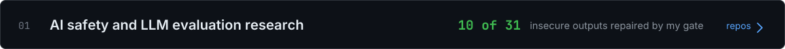

 

I design the experiment before I run it, and I report the results that did not improve.

- **[Glass Armor](https://github.com/sudarsan2507-hue/GLASS-ARMOR)**: My security gate's feedback repaired 10 of 31 insecure LLM migrations; test feedback repaired none (McNemar p = 0.002).
- **[DemoSearch](https://github.com/sudarsan2507-hue/DemoSearch)**: Hypotheses written before each run, across five tasks: a failure with a reason gives up to 3.3× the repairs of a blind retry.

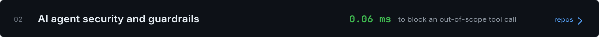

 

Three working systems on one problem: limiting the damage after a prompt injection lands.

- **[ChokeTap](https://github.com/sudarsan2507-hue/ChokeTap)**: Checks every tool call for policy, taint and intent; blocks an out-of-scope call in 0.06 ms.
- **[SentinelMind](https://github.com/sudarsan2507-hue/Sentinel_Mind)**: A second AI that watches an agent live and flags four kinds of failure.
- **[Engram](https://github.com/sudarsan2507-hue/Engram)**: Screens synced memories for poisoning; stopped 6 of 6 attacks in its demo.
- **[Aegis AI](https://github.com/sudarsan2507-hue/Aegis)**: ET AI Hackathon finalist; I owned the Fraud Shield module.

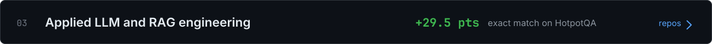

 

From a supervised NLP research internship at NIT Trichy, rated Excellent, with a paper under review.

- **[GradeRAG](https://github.com/sudarsan2507-hue/GradeRAG)**: +29.5 points exact match for GPT-4o-mini on HotpotQA; 5 of 6 model and dataset pairs improved.
- **[rag-browser-ai](https://github.com/sudarsan2507-hue/rag-browser-ai)**: A RAG pipeline that searches the web itself before answering.
- **[YT Knowledge Assistant](https://github.com/sudarsan2507-hue/yt-knowledge-assistant)**: Answers questions about a YouTube video from its transcript.

 

I publish data other people can train on, split so nothing leaks between train and test.

- **[iAudit](https://github.com/sudarsan2507-hue/iAudit)**: Two CNNs and three tabular models compared on brain age, checked on two outside datasets.
- **[BaseSVM](https://github.com/sudarsan2507-hue/BaseSVM)**: A linear support vector machine written from scratch, with no libraries.

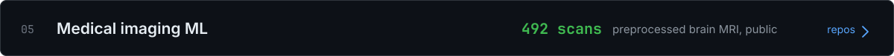

 

One line of work so far, not yet a specialisation.

- **[iAudit](https://github.com/sudarsan2507-hue/iAudit)**: Found that brain-age bias follows the scanner site, not the model. The 492 preprocessed scans are public on Kaggle.

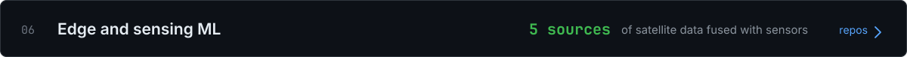

 

Hardware and ML together, on ESP32 boards.

- **[HydroFuse](https://github.com/sudarsan2507-hue/HydroFuse)**: Finds pipe leaks by combining soil and vibration sensors with five satellite sources.
- **[WISP](https://github.com/sudarsan2507-hue/WISP)**: Fall detection from Wi-Fi signals. Under one false alarm a week is the target, not yet a measured result.
- **[Syrinx](https://github.com/sudarsan2507-hue/Syrinx)**: Controls music on a phone with vocal sounds.
- **[Safe-Signal](https://github.com/sudarsan2507-hue/Safe-Signal)**: On-device distress detection from a hand signal, voice and movement.

## Recognition

<table>
  <tr><td><b>Winner</b> · Hack-N-Droid 2.0</td><td>VIT Chennai, March 2026. I built the ML login backend of <a href="https://github.com/prayag-1771/spatialAuth/tree/feature/ml-backend">spatialAuth</a>.</td></tr>
  <tr><td><b>Finalist</b> · ET AI Hackathon 2026</td><td><a href="https://github.com/sudarsan2507-hue/Aegis">Aegis AI</a>. I owned the Fraud Shield module.</td></tr>
  <tr><td><b>Selected</b> · Junction, Europe</td><td>Hand-picked from a global applicant pool.</td></tr>
  <tr><td><b>IEEE author</b></td><td><a href="https://ieeexplore.ieee.org/document/11610552">Interface Trap Charges on Schottky TFET for High-Frequency Application</a>, 2026.</td></tr>
  <tr><td><b>Research intern</b> · NIT Trichy</td><td>May to July 2026. Built GradeRAG; rated <i>Excellent</i>; paper under review.</td></tr>
  <tr><td><b>Two Kaggle datasets</b>, each with a DOI</td><td><a href="https://www.kaggle.com/datasets/sudarsan007r/isic-2019-preprocessed-leakage-free-split">ISIC 2019, leakage-free</a> and <a href="https://www.kaggle.com/datasets/sudarsan007r/ixi-t1-brain-mri-preprocessed-brain-age">IXI T1 brain MRI</a>.</td></tr>
</table>

## The question I work on

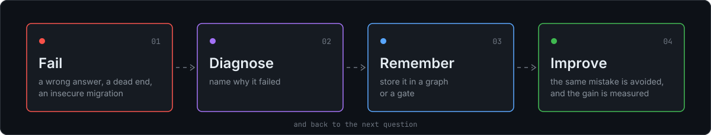


| Project | What I tested | What I found |
|:--|:--|:--|
| **[GradeRAG](https://github.com/sudarsan2507-hue/GradeRAG)** NIT Trichy internship | Does a RAG pipeline improve if it stores its wrong answers in a Mistake Knowledge Graph and gets them back as warnings? HotpotQA and TriviaQA, three LLMs. | **+29.5 points** exact match for GPT-4o-mini on HotpotQA. 5 of 6 model–dataset pairs improved; Qwen2.5-VL on TriviaQA got worse. |
| **[Glass Armor](https://github.com/sudarsan2507-hue/GLASS-ARMOR)** | Can LLMs safely migrate code to post-quantum cryptography? 400 migrations, 4 models, flaws planted so every test still passes. | My security gate's feedback let a model repair **10 of 31** insecure outputs; test feedback repaired none (McNemar p = 0.002). Ordinary tests missed all 71 planted flaws. |
| **[DemoSearch](https://github.com/sudarsan2507-hue/DemoSearch)** | When does failure feedback help a search? Graphs, 295 hard Sudoku puzzles, MetaQA, WebQSP and code repair, hypotheses written before each run. | A bare "dead end" changes nothing. A failure with a reason gives **2.5 to 3.3×** the repairs of a blind retry. |
| **[iAudit](https://github.com/sudarsan2507-hue/iAudit)** | Is brain-age bias in the model or the scanner? Two CNNs and three tabular models on IXI, checked on eNKI and SALD. | One scanner site is the worst for every model, so the bias comes from acquisition, not architecture. |

## Results, as they ran

Real screenshots from each project, with its headline number. Click a card to open the repo.

<table>
  <tr>
    <td width="50%"><a href="https://github.com/sudarsan2507-hue/GradeRAG">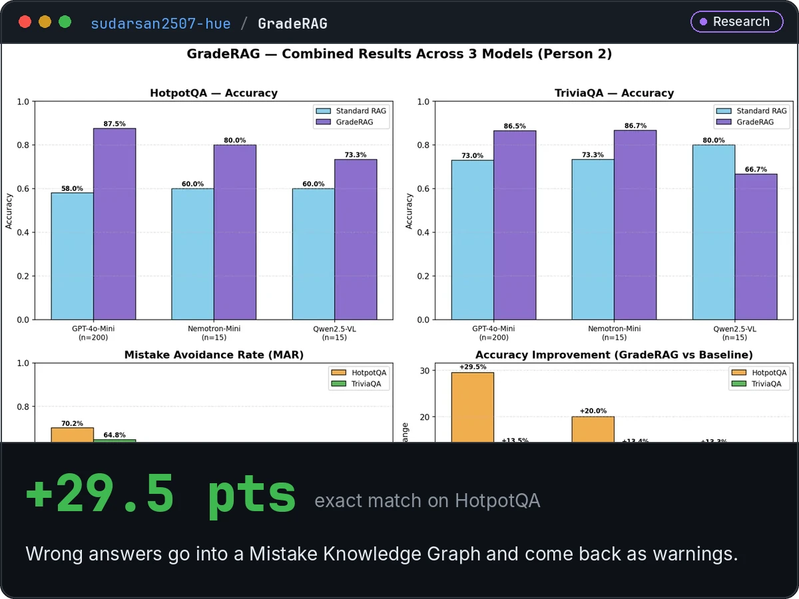</a></td>
    <td width="50%"><a href="https://github.com/sudarsan2507-hue/ChokeTap">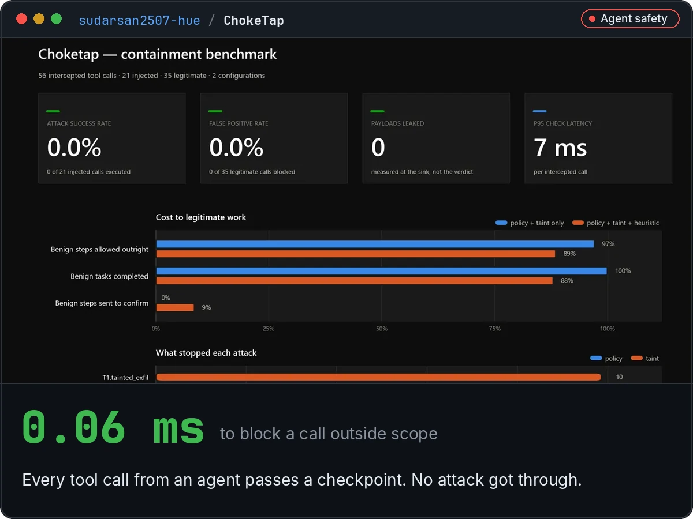</a></td>
  </tr>
  <tr>
    <td width="50%"><a href="https://github.com/sudarsan2507-hue/DemoSearch">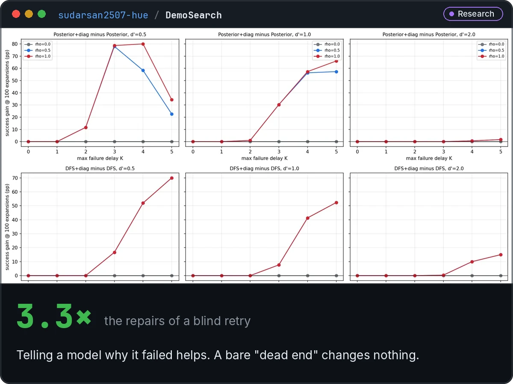</a></td>
    <td width="50%"><a href="https://github.com/sudarsan2507-hue/Sentinel_Mind">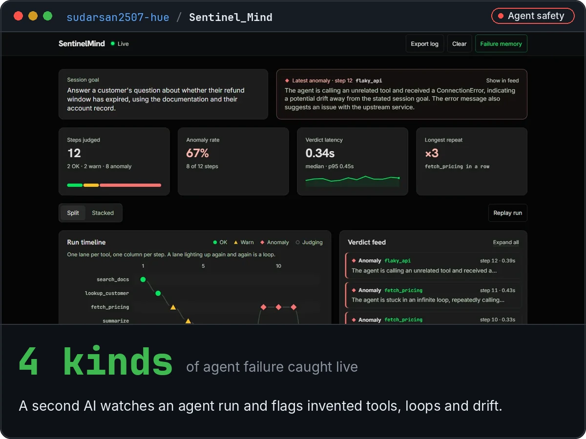</a></td>
  </tr>
  <tr>
    <td width="50%"><a href="https://github.com/sudarsan2507-hue/GLASS-ARMOR">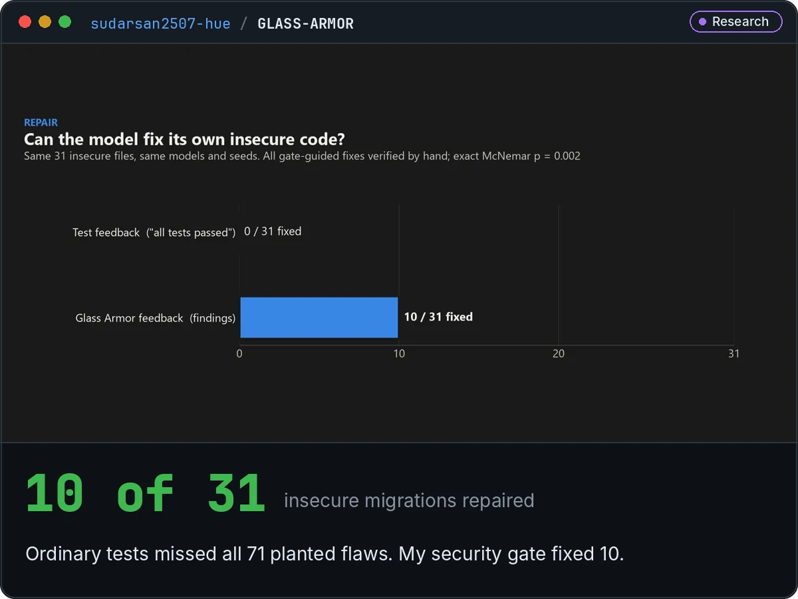</a></td>
    <td width="50%"><a href="https://github.com/sudarsan2507-hue/HydroFuse">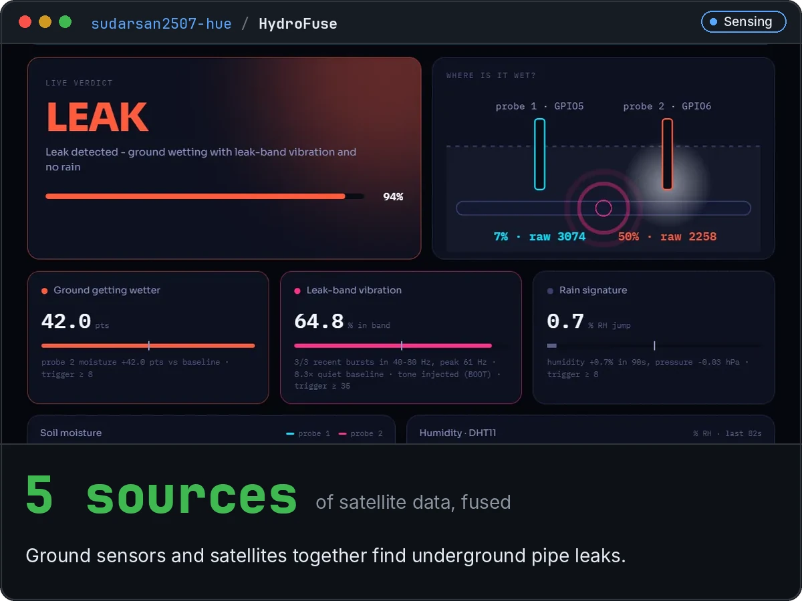</a></td>
  </tr>
</table>

## Open datasets

| Dataset | What is in it |
|:--|:--|
| **[IXI T1 brain MRI, preprocessed](https://www.kaggle.com/datasets/sudarsan007r/ixi-t1-brain-mri-preprocessed-brain-age)** [DOI](https://doi.org/10.34740/kaggle/dsv/21848925) · [starter notebook](https://www.kaggle.com/code/sudarsan007r/brain-age-from-mri-complete-starter-ixi-t1) | **492** scans, one per person, skull-stripped and registered to MNI152 at 1 mm, with age, sex, site and scanner in one labels file. Split 393 / 49 / 50 by subject, stratified by age decade. The scans behind the BrainAgeNeXt part of iAudit. Preprocessing is automatic and was not checked scan by scan. |
| **[ISIC 2019, leakage-free split](https://www.kaggle.com/datasets/sudarsan007r/isic-2019-preprocessed-leakage-free-split)** [DOI](https://doi.org/10.34740/kaggle/dsv/20910302) | **25,331** skin-lesion images in 8 classes, split by lesion so none appears in two splits. Cleaned and resized to 224 × 224; 0.3 GB, down from 9.1 GB. |

## Systems I built

| Project | What it does |
|:--|:--|
| **[Aegis AI](https://github.com/sudarsan2507-hue/Aegis)** | Joins scam calls, money-mule accounts and fake currency into one ranked case for police. 183 tests, 31 endpoints. |
| **[SentinelMind](https://github.com/sudarsan2507-hue/Sentinel_Mind)** | A second AI that watches an agent live and flags invented tools, loops and goal drift. |
| **[Choketap](https://github.com/sudarsan2507-hue/ChokeTap)** | A checkpoint every tool call must pass, so a prompt injection that lands still can't send data out. |
| **[Engram](https://github.com/sudarsan2507-hue/Engram)** | Offline memory for edge agents that screens synced memories for poisoning. 6 of 6 attacks stopped in the demo. |
| **[HydroFuse](https://github.com/sudarsan2507-hue/HydroFuse)** | Finds underground pipe leaks by combining ESP32 soil and vibration sensors with five satellite sources. |
| **[WISP](https://github.com/sudarsan2507-hue/WISP)** | Fall detection from Wi-Fi signals with two ESP32 boards. Target: under one false alarm a week. |
| **[Safe-Signal](https://github.com/sudarsan2507-hue/Safe-Signal)** | On-device distress detection from a hand signal, voice and movement. [Live demo](https://safe-signal-pi.vercel.app/). |

## Every project, in one line

<b>Research</b> &nbsp;<code>6</code>

 

| Project | What it is |
|:--|:--|
| **[Glass Armor](https://github.com/sudarsan2507-hue/GLASS-ARMOR)** | I tested whether LLMs can safely move code to post-quantum cryptography. Often they can't. |
| **[GradeRAG](https://github.com/sudarsan2507-hue/GradeRAG)** | A RAG pipeline that remembers its wrong answers and avoids repeating them. *NLP research internship.* [Live demo](https://sudarsan2507-hue.github.io/GradeRAG/mkg-explorer.html). |
| **[DemoSearch](https://github.com/sudarsan2507-hue/DemoSearch)** | A study of when telling a search agent about its failures actually helps. |
| **[iAudit](https://github.com/sudarsan2507-hue/iAudit)** | A fairness audit of models that estimate age from brain MRI. |
| **[BaseSVM](https://github.com/sudarsan2507-hue/BaseSVM)** | A linear support vector machine written from scratch, with no libraries. |
| **[Parametric FEA Sweep](https://github.com/sudarsan2507-hue/parametric-fea-sweep)** | Automated stress analysis of a cantilever beam, checked against beam theory. |

<b>Agent safety</b> &nbsp;<code>5</code>

 

| Project | What it is |
|:--|:--|
| **[Choketap](https://github.com/sudarsan2507-hue/ChokeTap)** | A checkpoint that every tool call from an AI agent must pass before it runs. |
| **[SentinelMind](https://github.com/sudarsan2507-hue/Sentinel_Mind)** | A second AI that watches an agent while it runs and flags its mistakes. |
| **[Engram](https://github.com/sudarsan2507-hue/Engram)** | Offline memory for AI agents on edge devices that can't be poisoned through sync. |
| **[WebMCP Forge](https://github.com/sudarsan2507-hue/CockPit)** | Generates WebMCP tools for a web app, then tests which ones are safe for an agent. *WebMCP Challenge.* |
| **[Aegis AI](https://github.com/sudarsan2507-hue/Aegis)** | Connects scam calls, money-mule accounts and fake currency into one case for the police. *Finalist.* |

<b>Sensing and hardware</b> &nbsp;<code>4</code>

 

| Project | What it is |
|:--|:--|
| **[WISP](https://github.com/sudarsan2507-hue/WISP)** | Detects a person falling from changes in Wi-Fi signals, using two ESP32 boards. |
| **[HydroFuse](https://github.com/sudarsan2507-hue/HydroFuse)** | Finds underground water-pipe leaks by combining ground sensors with satellite data. |
| **[Syrinx](https://github.com/sudarsan2507-hue/Syrinx)** | Controls music on a phone with sounds: shush to pause, whistle for louder. |
| **[SafeSignal](https://github.com/sudarsan2507-hue/Safe-Signal)** | A web app that notices signs of distress and prepares an alert for people you trust. [Live demo](https://safe-signal-pi.vercel.app/). |

<b>Apps</b> &nbsp;<code>11</code>

 

| Project | What it is |
|:--|:--|
| **[DatePilot](https://github.com/sudarsan2507-hue/DatePilot)** | Plans a date for two people in Chennai, Coimbatore or Madurai. [Live demo](https://datepilot.onrender.com). |
| **[CoDeg](https://github.com/sudarsan2507-hue/CoDeg)** | A two-player coding duel where faster code hits harder. |
| **[Phantom Voice](https://github.com/sudarsan2507-hue/PhantomVoice)** | A voice assistant whose only job is making sure I don't forget things. |
| **[StudentFrndly](https://github.com/sudarsan2507-hue/Student-frndly)** | Tracks how fast you are forgetting each skill and tells you what to revise today. |
| **[Med-Smart](https://github.com/sudarsan2507-hue/Med-Smart)** | A medication and health app for elderly people, their caregivers and doctors. |
| **[CLAS](https://github.com/sudarsan2507-hue/Personalised-Pedagogical-Assistant)** | A classroom tool that checks whether students understood, not just whether they attended. |
| **[Smart File Organizer](https://github.com/sudarsan2507-hue/smart-file-organizer)** | Sorts the files in a folder by what they say, not just their extension. |
| **[YT Knowledge Assistant](https://github.com/sudarsan2507-hue/yt-knowledge-assistant)** | Answers questions about a YouTube video from its transcript. |
| **[rag-browser-ai](https://github.com/sudarsan2507-hue/rag-browser-ai)** | A RAG pipeline that searches the web itself before answering. |
| **[Club Management System](https://github.com/sudarsan2507-hue/Club-Management-System)** | A club manager for members, events, attendance and funds, in plain JavaScript. |
| **[Cyber//Glitch](https://github.com/sudarsan2507-hue/Tundra-0727)** | A cybersecurity-themed landing page with glitch effects and animated telemetry. |

<b>Team builds</b> &nbsp;<code>8</code>

 

| Project | What it is |
|:--|:--|
| **[spatialAuth](https://github.com/sudarsan2507-hue/spatialAuth)** | Logs you in only inside a room it recognises, using the room itself as the key. *Winner.* |
| **[Synapse XR](https://github.com/sudarsan2507-hue/Synapse_XR)** | A remote expert guides a worker through AR, with holographic 3D hands. *DevsHouse.* |
| **[Landroid](https://github.com/sudarsan2507-hue/Landroid)** | Turns drone survey data into land health, tree cover and land value on a map. *Birdscale × VIT Chennai.* |
| **[ShowOnce](https://github.com/sudarsan2507-hue/ShowOnce)** | Show an agent a task once; it turns that into a checked, repeatable workflow. |
| **[CodeBase](https://github.com/sudarsan2507-hue/CodeBase)** | Connect a GitHub repo and ask questions about its code. |
| **[WebMCP Forge (Codex edition)](https://github.com/sudarsan2507-hue/CockPit-Codex)** | A second version of WebMCP Forge that runs the agent against safe test targets. *with fawaz_ah.* |
| **[WeatherGuard](https://github.com/sudarsan2507-hue/SIH-137)** | Shows the safest direction to move in extreme weather, and the nearest hospital or police station. *Smart India Hackathon.* |
| **[Hawkeye](https://github.com/sudarsan2507-hue/Hawkeye)** | Real-time safety monitoring from video, audio and crowd movement. |

Team credits for each build are in the [portfolio](https://sudarsan2507-hue.github.io/Portfolio/#detailed).

## Tools

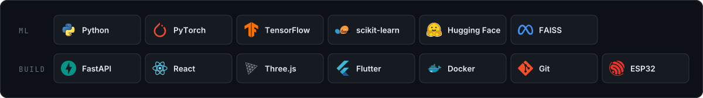

<picture>
  <source media="(prefers-color-scheme: dark)" srcset="https://raw.githubusercontent.com/sudarsan2507-hue/sudarsan2507-hue/output/snake-dark.svg">
  
</picture>

<b>Open to internships in AI research, agent safety and ML engineering.</b> <a href="mailto:sudarsan2507@gmail.com">sudarsan2507@gmail.com</a>

