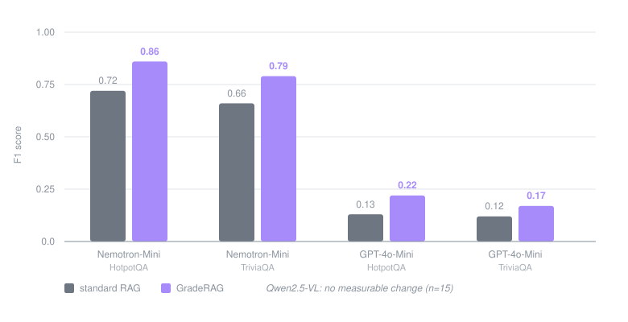

# Sudarsan Ravichandran

CSE (AI & ML) undergrad at VIT Chennai. Most of my work circles one question:
how do you stop a system from repeating a mistake it has already made?

That started as a retrieval problem and has since pulled me into graph search and
evaluation. Along the way I picked up audio ML, geospatial ML, and enough backend
work to deploy the things I build.

## Research

**GradeRAG**, failure-aware retrieval-augmented generation.
NLP research internship, NIT Trichy (May to June 2026).

Standard RAG has no memory of its own errors, so it repeats the same retrieval
mistake on every similar question. GradeRAG grades each answer, stores the failure
pattern in a memory-knowledge graph, and consults that graph when retrieving for
later queries. Benchmarked against a standard RAG baseline on HotpotQA and
TriviaQA across three LLMs.

Exact numbers

| Model | Dataset | Baseline F1 | GradeRAG F1 | Δ |
|---|---|---|---|---|
| Nemotron-Mini | HotpotQA | 0.72 | 0.86 | **+14.3** |
| Nemotron-Mini | TriviaQA | 0.66 | 0.79 | **+13.3** |
| GPT-4o-Mini | HotpotQA | 0.13 | 0.22 | **+9.0** |
| GPT-4o-Mini | TriviaQA | 0.12 | 0.17 | **+5.2** |
| Qwen2.5-VL | both | n/a | n/a | flat |

Qwen2.5-VL showed no measurable improvement, and the local-model runs were on a
small sample (n=15), so the Nemotron numbers need a larger evaluation before I
would lean on them.

**[GLASS-ARMOR](https://github.com/sudarsan2507-hue/GLASS-ARMOR)**, security of LLM-driven
post-quantum migrations. Teams are moving from RSA and elliptic curves to ML-KEM and
ML-DSA, much of that rewrite will be done by LLMs, and the existing tests will say it
worked. I built a benchmark of one-flaw variants that pass every test, ran 400 real
migrations across four models, and wrote a security gate (static rules plus adversarial
probes against the running code). Functional tests caught 0 of 71 planted flaws. Gate
feedback repaired 10 of 31 insecure outputs where test feedback repaired 0 (McNemar
p = 0.002). The gate was developed on this benchmark; on six new variants written
afterwards it caught 4.

**[iAudit](https://github.com/sudarsan2507-hue/iAudit)**, fairness audit of brain-age
prediction. Is the bias in the model or in the scanner? I ran two CNNs (DeepBrainNet,
BrainAgeNeXt) next to three plain tabular models on 560 IXI MRI scans, then checked the
findings on eNKI and SALD. One site, IOP, is the worst for every model, CNN or tabular
(DeepBrainNet error 11.5 years there vs 4.4 at Guys), which points to the acquisition,
not the architecture. I added an unsupervised reliability score that flags scans that
look unlike the training sites.

**[DemoSearch](https://github.com/sudarsan2507-hue/DemoSearch)**, graph search for
multi-hop knowledge-graph QA. An earlier run at the same idea: when a reasoning
path fails, revive the paths that were wrongly rejected earlier instead of
restarting. Evaluated against a greedy baseline with paired t-tests and 95%
confidence intervals, across rule-based, embedding (BGE), and hybrid verifiers.

**Publication.** P. Sharma, **Sudarsan Ravichandran**, V. V. Saxena, P. Kumar, and
R. Tiwari, "Investigation of Interface Trap Charges on Schottky TFET for High
Frequency Application." Accepted at VLSI SATA. TCAD study on a 50 nm Double-Gate
Schottky Tunnel FET, from earlier work outside ML.

## Hackathons

| Project | What it does | What I built |
|---|---|---|
| **[spatialAuth](https://github.com/prayag-1771/spatialAuth)**  | Authentication that treats the room you are standing in as the credential, from acoustic, WiFi, and magnetic signatures | ML backend: One-Class SVM over sensor signatures, FastAPI enrollment and auth API, multi-room support |
| **Landroid** | AI land-intelligence platform | ML pipeline: NDVI vegetation analysis, ARIMA forecasting, raster validation, plant-zone detection |
| **Hawkeye** | Real-time acoustic threat detection | Audio module: YAMNet transfer learning on a live 16 kHz stream, confidence thresholding, evidence capture |
| **[SIH-137](https://github.com/sudarsan2507-hue/SIH-137)** | Weather-safety dashboard routing users toward safer nearby locations | Backend data models, services layer, Vite build and CI |

Winner, Hack-N-Droid 2.0 (SEQATO × VIT Chennai). All four were team projects;
my spatialAuth work is on the `feature/ml-backend` branch.

## Building

| Project | What it does | Stack |
|---|---|---|
| **[SentinelMind](https://github.com/sudarsan2507-hue/Sentinel_Mind)** | Watches an AI agent while it runs and flags invented tools, loops and goal drift; guard mode blocks the bad step | Flask, Socket.IO, React, Groq, 207 tests |
| **[Safe-Signal](https://github.com/sudarsan2507-hue/Safe-Signal)** | On-device distress detection from a hand signal, voice tension and sudden movement, no server ([live](https://safe-signal-pi.vercel.app/)) | React, MediaPipe, Web Audio, Vite |
| **[Engram](https://github.com/sudarsan2507-hue/Engram)** | Offline memory for edge AI agents that screens synced memories for poisoning before trusting them | Qdrant Edge, Ed25519 signing, FastAPI, Docker |
| **[Student-frndly](https://github.com/sudarsan2507-hue/Student-frndly)** | Skill tracker that models decay over time | Express, JWT with server-side revocation, bcrypt, Google OAuth, SQLite, Jest |
| **[yt-knowledge-assistant](https://github.com/sudarsan2507-hue/yt-knowledge-assistant)** | RAG over YouTube transcripts for faster review | 384-dim embeddings, manual cosine similarity, 1 to 2 min per 10-min video |
| **[Med-Smart](https://github.com/sudarsan2507-hue/Med-Smart)** | Medication adherence app for elderly users | Flutter, Firebase, accessibility-focused UI |

## Tools

## Activity

<picture>
  <source media="(prefers-color-scheme: dark)" srcset="https://raw.githubusercontent.com/sudarsan2507-hue/sudarsan2507-hue/output/snake-dark.svg">
  
</picture>

---

Currently going deeper into LLMs, retrieval systems, and the algorithmic side of ML.
Open to ML/AI internships.

[LinkedIn](https://www.linkedin.com/in/sudarsan-ravichandran-82b209391/) · sudarsan2507@gmail.com
