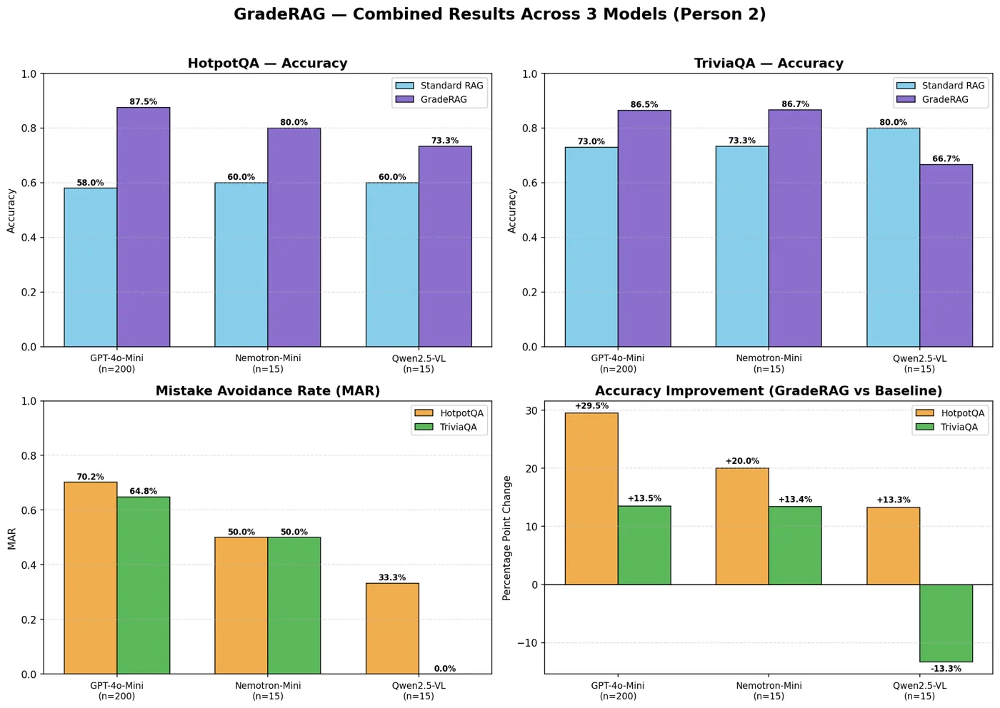
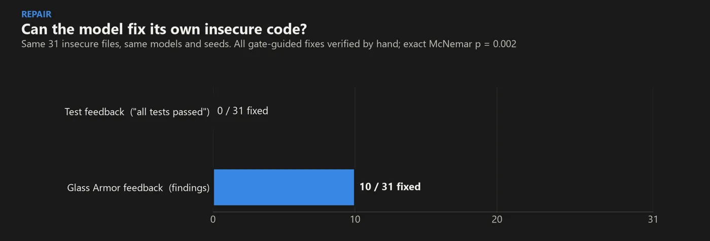
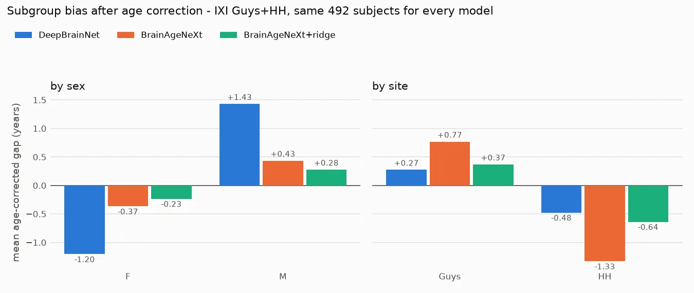
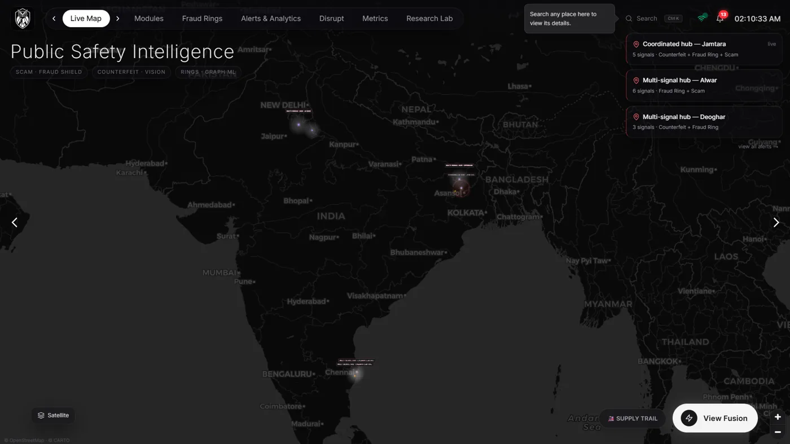
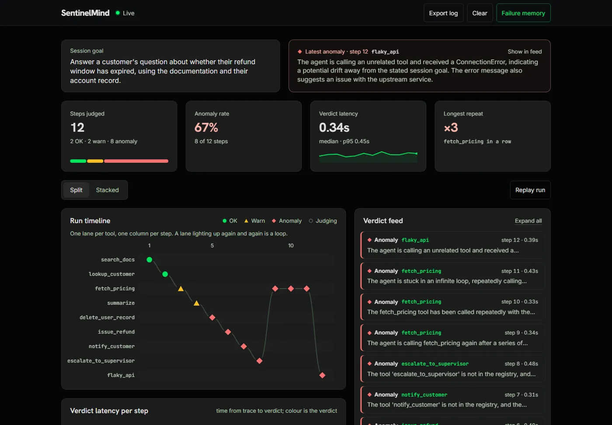
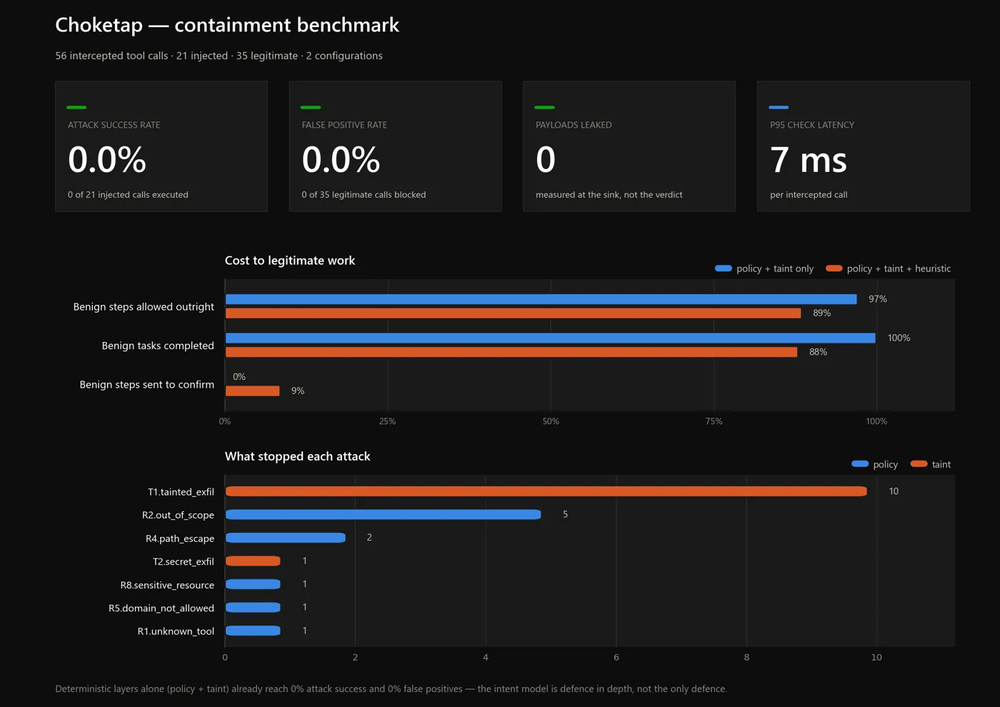
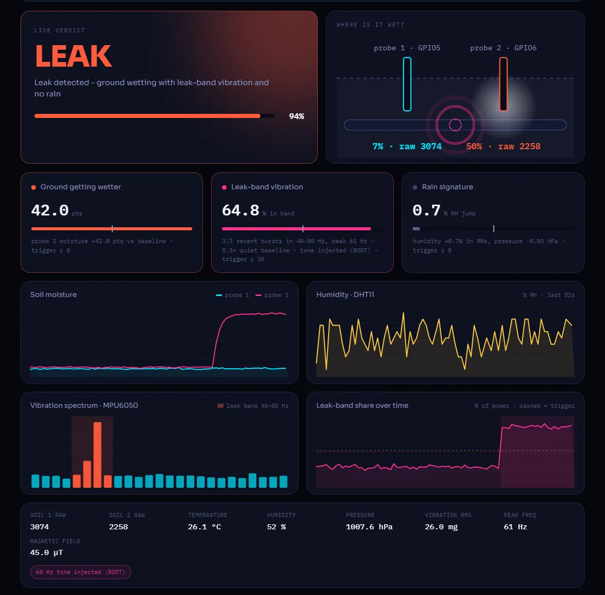

# Sudarsan Ravichandran

**I build AI that learns from its mistakes.**
CSE (AI & ML) at VIT Chennai · IEEE author · NLP research intern, NIT Trichy

**[→ Open my portfolio](https://sudarsan2507-hue.github.io/Portfolio/)** · [2-minute version](https://sudarsan2507-hue.github.io/Portfolio/#crisp) · [full 3D tour](https://sudarsan2507-hue.github.io/Portfolio/#detailed)

---

Most of my work asks one question: **how do you stop a system from repeating a mistake it has already made?**
It started in retrieval and pulled me into graph search, agent safety and evaluation, and I report the
results that stayed flat too.

### Highlights

| | |
|---|---|
| 🏆 **Winner, Hack-N-Droid 2.0** | VIT Chennai, Mar 2026 · [spatialAuth](https://github.com/prayag-1771/spatialAuth/tree/feature/ml-backend), I built the ML authentication backend |
| 🥈 **Finalist, ET AI Hackathon 2026** | [Aegis AI](https://github.com/sudarsan2507-hue/Aegis), I owned the Fraud Shield module |
| 🌍 **Selected for Junction, Europe** | Hand-picked from a global applicant pool |
| 📄 **IEEE publication** | [Interface Trap Charges on Schottky TFET for High-Frequency Application](https://ieeexplore.ieee.org/document/11610552) |
| 🎓 **Research intern, NIT Trichy** | GradeRAG, failure-aware RAG · rated *Excellent* · paper under review |
| 📊 **Kaggle dataset with DOI** | [ISIC 2019, leakage-free split](https://www.kaggle.com/datasets/sudarsan007r/isic-2019-preprocessed-leakage-free-split): 25,331 images, 0 lesions shared across splits |

### Research

<table>
<tr>
<td width="50%" valign="top">

**[GradeRAG](https://github.com/sudarsan2507-hue/GradeRAG)**: RAG with a memory of its own mistakes.
Wrong answers go into a Mistake Knowledge Graph and come back as warnings on similar questions.
**+29.5 pts** exact match (GPT-4o-mini, HotpotQA).

</td>
<td width="50%" valign="top">

**[Glass Armor](https://github.com/sudarsan2507-hue/GLASS-ARMOR)**: LLM-written post-quantum migrations pass tests but fail security.
400 migrations, 4 models. Tests caught **0 of 71** planted flaws; my gate's feedback fixed **10 of 31** (tests: 0).

</td>
</tr>
<tr>
<td valign="top">

**[iAudit](https://github.com/sudarsan2507-hue/iAudit)**: is brain-age bias in the model or the scanner?
560 MRI scans, two CNNs vs tabular models. One site is worst for every model, so the cause is the acquisition.

</td>
<td valign="top">

**[DemoSearch](https://github.com/sudarsan2507-hue/DemoSearch)**: when does failure feedback help a search agent?
Pre-registered study across graphs, Sudoku, KG-QA and code repair. Telling a model *why* a test failed gives **2.5–3.3×** the repairs.

</td>
</tr>
</table>

### Agent safety and systems

<table>
<tr>
<td width="50%" valign="top">

**[Aegis AI](https://github.com/sudarsan2507-hue/Aegis)**: joins scam calls, mule accounts and fake currency into one case for police. ET AI Hackathon finalist.

</td>
<td width="50%" valign="top">

**[SentinelMind](https://github.com/sudarsan2507-hue/Sentinel_Mind)**: a second AI that watches an agent live and flags invented tools, loops and goal drift.

</td>
</tr>
<tr>
<td valign="top">

**[Choketap](https://github.com/sudarsan2507-hue/ChokeTap)**: a checkpoint every agent tool call must pass; a landed prompt injection still can't exfiltrate.

</td>
<td valign="top">

**[HydroFuse](https://github.com/sudarsan2507-hue/HydroFuse)**: finds underground pipe leaks by fusing ESP32 soil and vibration sensors with satellite data.

</td>
</tr>
</table>

<b>More projects</b>

| Project | What it does |
|---|---|
| [Engram](https://github.com/sudarsan2507-hue/Engram) | Offline memory for edge AI agents that screens synced memories for poisoning |
| [Safe-Signal](https://github.com/sudarsan2507-hue/Safe-Signal) | On-device distress detection from a hand signal, voice and movement · [live](https://safe-signal-pi.vercel.app/) |
| [WISP](https://github.com/sudarsan2507-hue/WISP) | Fall detection from Wi-Fi signals with two ESP32 boards |
| [DatePilot](https://github.com/sudarsan2507-hue/DatePilot) | Constraint-checked date planner for two people · [live](https://datepilot.onrender.com) |
| [Syrinx](https://github.com/sudarsan2507-hue/Syrinx) | Control music on a phone with vocal sounds (MFCC + SVM) |
| [CoDeg](https://github.com/sudarsan2507-hue/CoDeg) | Real-time coding duel where faster code hits harder |
| [Student-frndly](https://github.com/sudarsan2507-hue/Student-frndly) | Skill tracker that models forgetting over time |
| [Landroid](https://github.com/sudarsan2507-hue/Landroid), [Hawkeye](https://github.com/sudarsan2507-hue/Hawkeye), [Synapse XR](https://github.com/sudarsan2507-hue/Synapse_XR) | Team hackathon builds: ML pipeline, audio module, AI models |

All 34 projects are in the **[portfolio](https://sudarsan2507-hue.github.io/Portfolio/#detailed)**.

### Tools

<picture>
  <source media="(prefers-color-scheme: dark)" srcset="https://raw.githubusercontent.com/sudarsan2507-hue/sudarsan2507-hue/output/snake-dark.svg">
  
</picture>

**Open to ML / AI internships.** Let's build something that learns.

